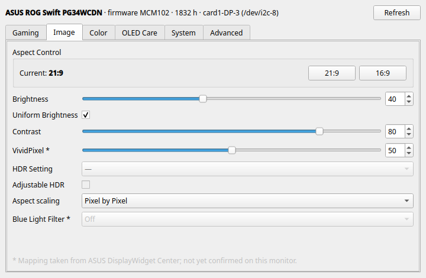

# pg34ctl

Control an **ASUS ROG Swift OLED PG34WCDN** from the PC instead of the OSD joystick,
on Linux and Windows. A settings window in the spirit of ASUS DisplayWidget Center, plus
a CLI that can switch the monitor between **21:9 and 16:9** — something neither the
monitor's DDC/CI interface nor DisplayWidget Center offers directly.

```
pg34ctl aspect 16:9      # monitor becomes a native 2560x1440 display
pg34ctl aspect 21:9      # back to 3440x1440
pg34ctl                  # open the settings window
```



> **Status:** works on Linux (tested on Fedora / KDE Plasma 6, AMD GPU, firmware MCM102).
> **Windows support is experimental:** the backend is written against the documented
> Win32 APIs but has not run on Windows yet. Reports are welcome.
>
> **Other monitors:** only the PG34WCDN is supported. Other ASUS ROG monitors share most
> DDC/CI codes, but the OSD menu path used for the aspect switch is model-specific and
> the code refuses to run on anything else. Pull requests that add a model, with its
> mapped menu path, are welcome.

## Install

Needs [uv](https://docs.astral.sh/uv/).

```sh
uv tool install git+https://github.com/Tiaxi/pg34ctl   # puts pg34ctl and pg34ctl-gui on PATH
```

**Linux:** DDC/CI needs the `i2c-dev` kernel module and access to `/dev/i2c-*`. If
`ddcutil detect` works without sudo, so does this. For a launcher entry:
`cp contrib/pg34ctl.desktop ~/.local/share/applications/`.

**Windows:** nothing extra; it uses the built-in Monitor Configuration API (dxva2).

Either way, **DDC/CI must be on** in the OSD (System Setup → OSD Setup; it can only be
changed while VRR is off).

## How the aspect switch works

The PG34WCDN has no DDC/CI code for Aspect Control: ASUS' own code for it (`0xD3`) is
neither advertised nor implemented on firmware MCM101/MCM102. So `pg34ctl aspect`
drives the OSD remotely with the same virtual joystick presses DisplayWidget Center uses
(`0xEB`), along the path *Image → Aspect Control → ratio → Pixel by Pixel*, then sets the
scaling directly through the standard `0x86` code.

The ratio itself is not readable over DDC/CI either, but the monitor swaps its EDID: in
16:9 mode it advertises 2560×1440 as native. pg34ctl reads the current mode from the
EDID and uses it to confirm every switch. A switch takes about 10 seconds. KDE follows
the new native mode on its own; on Windows pg34ctl sets the desktop resolution afterwards.

Requirements for the menu path to be right:

- **HDR off** (pg34ctl refuses otherwise; the HDR menu layout is unmapped),
- **PIP/PBP off** and **ELMB off** (both grey out Aspect Control),
- **Quick Menu emptied**, so the menu button opens the full menu (MCM102 added the
  Quick Menu; removing all of its entries brings the old behaviour back).

If the monitor does not switch within 15 seconds, pg34ctl closes the menu and reports it.

**Windows alternative for streaming:** with GPU scaling enabled in the AMD driver,
Windows can run a 2560×1440 desktop with black bars without touching the monitor.

## What is controllable

`pg34ctl list` shows every setting with its current value. Codes come from ASUS
DisplayWidget Center's decompiled `VCPAPI` and from live diffs on a PG34WCDN. Settings
marked `?` (CLI) or `*` (window) follow DisplayWidget Center's tables but have not been
confirmed on this monitor yet.

Things that are **not** reachable over DDC/CI on this monitor: Aspect Control (hence the
OSD route), Display Color Space, OLED Anti-Flicker, the Quick Menu contents, and DSC.

Firmware updates reset the monitor to factory defaults, which on EU units includes
**Power Saving Mode**; that greys out VRR, GamePlus, Shadow Boost and more. Set
*Power Setting → Performance Mode* (`pg34ctl set power_setting performance`) to undo it.

## Development

```sh
uv sync
uv run pytest
uv run ruff check . && uv run ruff format .
```

The Windows backend is checked for struct layouts but has not yet run on Windows.

## License

MIT. Not affiliated with or endorsed by ASUS. ROG, ROG Swift and DisplayWidget Center
are trademarks of ASUSTeK Computer Inc.
